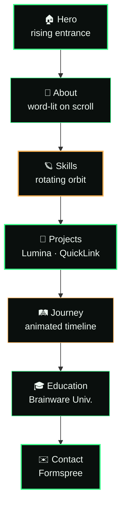
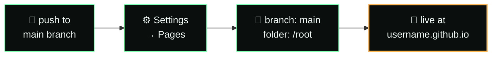

<div align="center">

# `>_` prem.dev

### building software that feels effortless.


[](https://github.com/techprem324)
[](./Prem_Kumar_Srivastava_Resume.pdf)
[](#license)

</div>

<br>

```diff
+ status : shipping
+ stack  : html · css · javascript
+ vibe   : dark · minimal · terminal-core
```

<br>

## ⟢ what's inside

<table>
<tr>
<td width="50%" valign="top">

**A single-file portfolio.**
No build step. No `node_modules`. No framework tax.
Open `index.html`, that's the whole app.

- 🪐 rotating skill orbit instead of a boring list
- 📈 scroll-linked journey timeline
- 📱 real project screenshots in phone mockups
- ✉️ working contact form (Formspree)
- 🎬 rising, staggered hero entrance
- 🌓 respects `prefers-reduced-motion`

</td>
<td width="50%" valign="top">

```
prem-portfolio/
├─ index.html      → everything lives here
├─ lumina.png       → Hotel Lumina screenshot
├─ quicklink.png    → URL Shortener screenshot
├─ Prem_..._Resume.pdf
└─ README.md        → you are here
```

</td>
</tr>
</table>

<br>

## ⟢ how a visitor flows through it



<br>

## ⟢ tech radar

<div align="center">

**Core**
<br>


**Frontend**
<br>


**Backend**
<br>


**Data & ML**
<br>


**Tools**
<br>


</div>

<br>

## ⟢ featured builds

<table>
<tr>
<th align="left">project</th>
<th align="left">stack</th>
<th align="left">live</th>
</tr>
<tr>
<td>🏨 <b>Hotel Lumina</b><br><sub>luxury dining meets seamless reservations</sub></td>
<td><code>React</code> <code>Node</code> <code>Express</code> <code>MySQL</code></td>
<td><a href="https://hotel-lumina-m.vercel.app">visit ↗</a></td>
</tr>
<tr>
<td>🔗 <b>URL Shortener 2.0</b><br><sub>short links, smart analytics</sub></td>
<td><code>Node</code> <code>Express</code> <code>MongoDB</code></td>
<td><a href="https://url-shortner-1-0.onrender.com">visit ↗</a></td>
</tr>
</table>

<br>

## ⟢ run it

```bash
# clone
git clone https://github.com/techprem324/<this-repo>.git
cd <this-repo>

# just open it — zero dependencies
open index.html          # macOS
start index.html         # Windows

# or serve it properly
python3 -m http.server 8000
```

<br>

## ⟢ deploy — GitHub Pages, 60 seconds



Push → Settings → Pages → pick `main` / `root` → done. No CI, no build, no config files.

<br>

## ⟢ making it yours

<details>
<summary><b>swap the contact form</b></summary>
<br>

Find this line near the bottom of `index.html`:
```js
const FORM_ID="xdekdbyd";
```
Replace `xdekdbyd` with your own [Formspree](https://formspree.io) form ID.
</details>

<details>
<summary><b>update the resume</b></summary>
<br>

Drop a new PDF into the folder named exactly:
```
Prem_Kumar_Srivastava_Resume.pdf
```
The download button picks it up automatically — no code changes needed.
</details>

<details>
<summary><b>replace project screenshots</b></summary>
<br>

Overwrite `lumina.png` / `quicklink.png` with new images of the same name and dimensions.
</details>

<br>

---

<div align="center">

<sub>built line by line by <b>Prem Kumar Srivastava</b> · Kolkata, India</sub>

[](https://github.com/techprem324)
[](https://linkedin.com/in/prem-kumar-srivastava-324pp)
[](https://x.com/prem_sri889)

</div>
